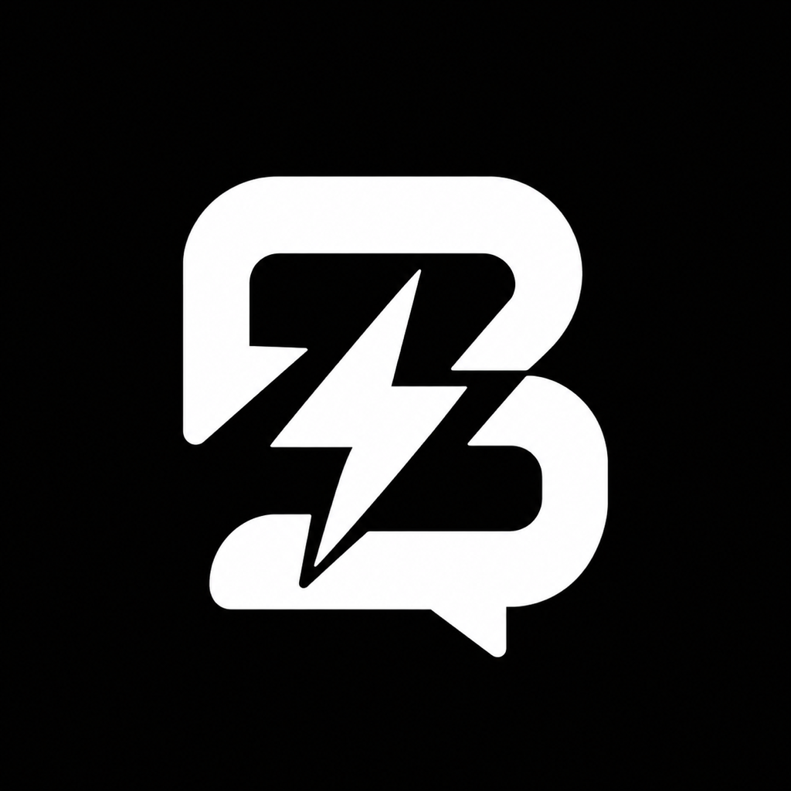

#  Botge

Botge brings 7TV emotes to Discord. The Rust bot handles emote commands, voice, and the Activity
API. The TypeScript Discord Activity runs from a signed Go origin and lets members browse and
compose emotes. Administrators can manage settings and restore earlier catalog revisions. The
SwiftUI iOS app offers the same server features and a Guess game with a Lock Screen Live Activity.

## Documentation

The [Botge wiki](https://github.com/MrewyOrg/Botge/wiki) is the main documentation site.

- [Using Botge: commands and Activity](https://github.com/MrewyOrg/Botge/wiki/Activity)
- [Hosting and configuration](https://github.com/MrewyOrg/Botge/wiki/Hosting)
- [Operations and troubleshooting](https://github.com/MrewyOrg/Botge/wiki/Operations)
- [Development](https://github.com/MrewyOrg/Botge/wiki/Development)
- [Roadmap](https://github.com/orgs/MrewyOrg/projects/2/views/6)

## Source references

Implementation details stay versioned with the code.

- [`crates/`](crates/) contains the Rust workspace. See the [architecture](docs/ARCHITECTURE.md) and
  [workspace guide](crates/README.md).
- [`activity/`](activity/) contains the browser client, Go origin, and their
  [workspace tooling](activity/README.md).
- [`ios/`](ios/) contains the [iOS app and its setup guide](ios/README.md).
- [`tests/`](tests/) documents the [test suites and coverage](tests/README.md).
- [`botge_control/`](botge_control/) contains the
  [Debian installation and control scripts](botge_control/README.md).
- [GitHub workflows](.github/workflows/README.md) describe validation and approved deployment.
- [Production contracts](docs/PRODUCTION.md) cover readiness, image verification, and recovery.

## Project information

The [cost policy](docs/PRODUCTION.md#cost-policy) requires new tooling and infrastructure to remain
free to use.

Review the [terms](docs/TERMS.md) and [privacy guidance](docs/PRIVACY.md) before hosting. See
[releases](https://github.com/MrewyOrg/Botge/releases),
[discussions](https://github.com/MrewyOrg/Botge/discussions), and
[issues](https://github.com/MrewyOrg/Botge/issues).

Botge is licensed under the [MIT License](LICENSE.txt).
