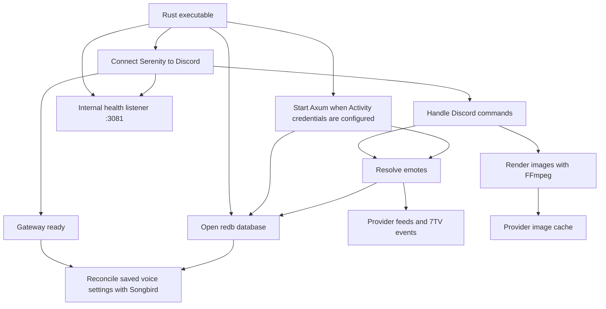
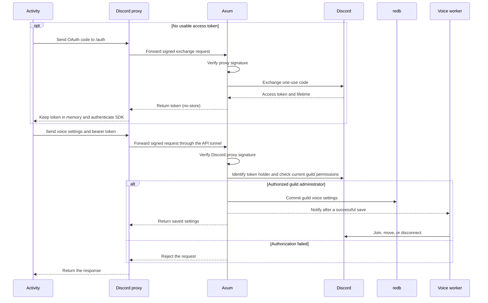
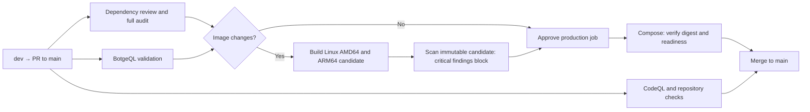

# Rust bot architecture

The production image builds one [Rust binary](../Cargo.toml). Discord commands and the Activity API
share the same emote catalog. The [Activity and Worker](../activity/README.md) are TypeScript.

## Diagram exports

The PNG diagrams describe the current Rust implementation:

- [Bot modules](architecture.png): adapters, shared services, rendering, and persistence.
- [Request and data flow](request-flow.png): Discord commands and authenticated Activity requests.
- [Deployment topology](deployment.png): Compose services, persistent data, and the optional API
  tunnel.
- [Development and release workflow](development-workflow.png): local hooks, PR validation, and
  approved deployment.
- [Startup and shutdown](startup.png): initialization, optional services, and gateway readiness.
- [Discord interactions](discord-interactions.png): extensible command, autocomplete, modal, and
  message handling.

Diagrams show architectural boundaries rather than an exhaustive feature list. New ports reuse the
command and interaction handlers; only implemented handlers are active. The request-flow diagram
illustrates emote rendering and an Activity voice-settings save. Personal border requests identify
the caller without requiring guild authorization.

## Startup and dependencies



The root Cargo manifest builds one executable from [`src/`](../src/). The startup module wires the
dependencies together. The Activity routes validate input and translate failures into HTTP
responses. The Discord adapter exchanges OAuth codes and checks permissions. Storage owns redb
transactions, and the voice worker applies settings to Discord.

The larger services separate their internal responsibilities into child modules:

- [`commands.rs`](../src/commands.rs) dispatches to [`commands/`](../src/commands/): composition,
  message prefixes, autocomplete, shortcuts, registration, and cleanup.
- [`activity.rs`](../src/activity.rs) shares authentication and state across the voice, catalog, and
  personal border routes in [`activity/`](../src/activity/).
- [`providers.rs`](../src/emotes/providers.rs) keeps networking and snapshots separate from
  [`normalization.rs`](../src/emotes/providers/normalization.rs) and
  [`events.rs`](../src/emotes/providers/events.rs).
- [`rendering.rs`](../src/emotes/rendering.rs) coordinates downloads and encoding; its
  [`child modules`](../src/emotes/rendering/) own layout planning, media probing, and WebP timing.

Feature tests live in each child module's `tests.rs`. Parent test modules retain shared fixtures and
scenarios that exercise dispatch, authentication, networking, or the complete render pipeline.

The internal health listener is independent of the Activity API. It exposes process liveness at
`/healthz` and gateway readiness at `/readyz`. Ready/Resumed enables readiness; reconnect stages
remove it without failing liveness. `--healthcheck` checks local readiness, and `--verify-database`
reads an offline redb backup without loading Discord credentials. See
[production operations contracts](PRODUCTION.md).

## Activity request flow



The diagram shows a voice settings save. Discord maps `/` to the Worker, which verifies the signed
HTML request, and `/botge-api` to the bot's API tunnel. The API verifies signatures independently.

Guild owners and administrators can manage voice and emote settings. Members can read the server
catalog. Adding or removing emotes follows the server's emote management policy, and personal border
settings use the authenticated user's ID.

The API offers voice channels the bot can view and join. Startup, gateway resume, and a periodic
check reconcile the saved channel. Clearing it requests a disconnect. The optional voice status
emoji stays saved when the toggle is off.

## Emote catalog and rendering

Each guild catalog combines individually added emotes, configured provider sets, and global feeds in
that order. Only enabled providers contribute entries. A single 7TV WebSocket invalidates affected
snapshots after changes. Timed refreshes and a reconnect refresh cover missed events. Autocomplete
can use cached results when a provider is slow. The shared refresh continues in the background so
later requests can use the updated snapshot. Added emotes and guild settings use separate redb
tables. The add transaction checks duplicate IDs and names, and the API checks guild membership and
roles before writing.

Discord defers emote interactions while it resolves names and reads media. Downloads use provider
CDN allowlists and the nginx cache where available. The renderer admits one request at a time, caps
file sizes, and runs FFmpeg on local image files. Columns follow the Activity preview's proportions.
The renderer synchronizes each overlaying group before compositing so all layers retain their
timing. Animated compositions export WebP with variable frame delays and use the longest source
animation's duration.

## Validation

`rust-toolchain.toml` pins the nightly shared by development, CI, and Docker. Development installs
the default profile, LLVM coverage tools, and standard library sources for editor navigation. CI
installs only the compiler, Clippy, rustfmt, and LLVM coverage tools; the Docker builder installs
only the minimal compiler profile. See the [workflow guide](../.github/workflows/README.md).

Install Rust through rustup and provide Opus development headers and libraries through your package
manager. Use `opus` and `pkg-config` on macOS with Homebrew or `libopus-dev` and `pkg-config` on
Debian.

```sh
cargo fmt --all --check
cargo clippy --locked --all-targets -- -D warnings
cargo doc --locked --no-deps --document-private-items
sh scripts/check-rust-coverage.sh
npm run check:static
npm run test:coverage
npm run check:markup -w activity
```

Rust and TypeScript enforce 90% coverage per runtime source file. Rustdoc and Clippy validate
private contracts as well as public ones. Run Activity builds and tests sequentially because Worker
tests mock the generated HTML module. See the [test guide](../tests/README.md).

For a live test, export `DISCORD_TOKEN` and `APP_ID` for a separate Discord test application. Export
`DISCORD_ACTIVITY_CLIENT_SECRET` and `DISCORD_ACTIVITY_PUBLIC_KEY` to enable the local API on
`127.0.0.1:3080`. Start the bot from the repository root with a fresh test database and register the
commands on that application:

```sh
BOTGE_DATA_DIR="$(mktemp -d)" BOTGE_REGISTER_COMMANDS=true cargo run --locked
```

Enable Discord proxy authentication and build the test Activity with
`VITE_ENABLE_ACTIVITY_SETTINGS=true`. Point the test application's API URL mapping at the test
backend through the proxy described in the Activity guide. Check startup, channel selection and
deselection, reconnect, and status permissions on a test server.

## Deployment



The [deployment workflow](../.github/workflows/README.md) promotes the candidate digest and requests
the VM update through the control socket over Google Cloud IAP. The handler deploys and persists the
approved image reference. See the [zero-cost policy](PRODUCTION.md#cost-policy). The
[Activity Worker](../activity/README.md) has its own build and publish steps. For a live release
check, verify commands, guild catalog permissions, and voice in Discord. Check
[resource usage](RESOURCE_USAGE.md) during an animated composition with voice connected.

See the [roadmap](https://github.com/orgs/MrewyOrg/projects/2/views/6) for planned commands and
integrations.
