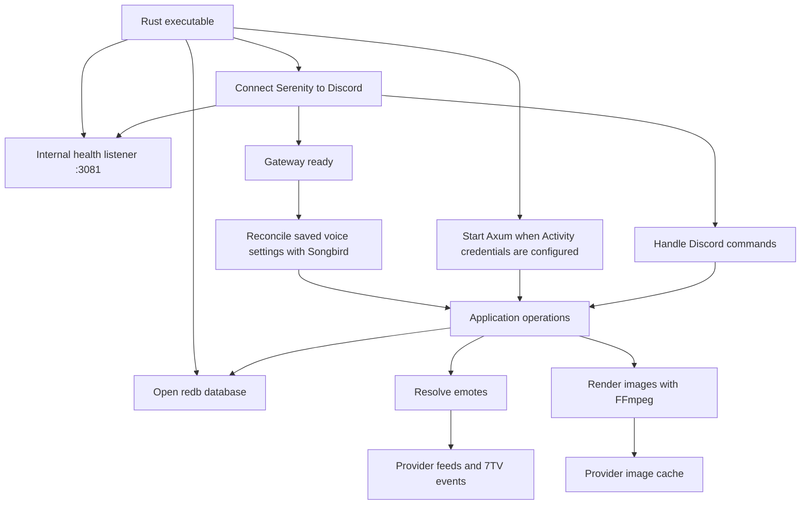
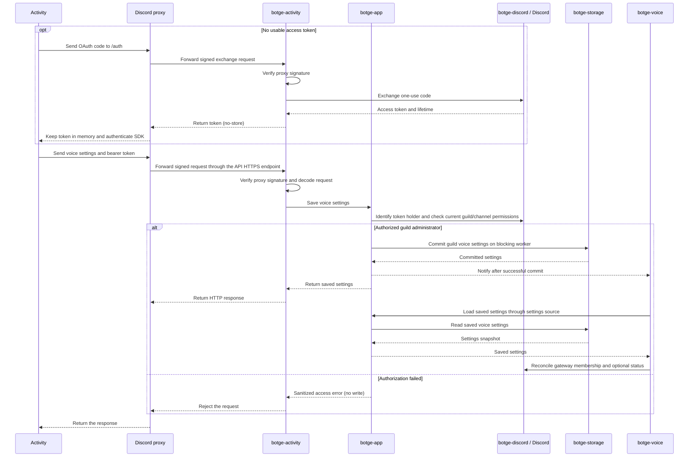
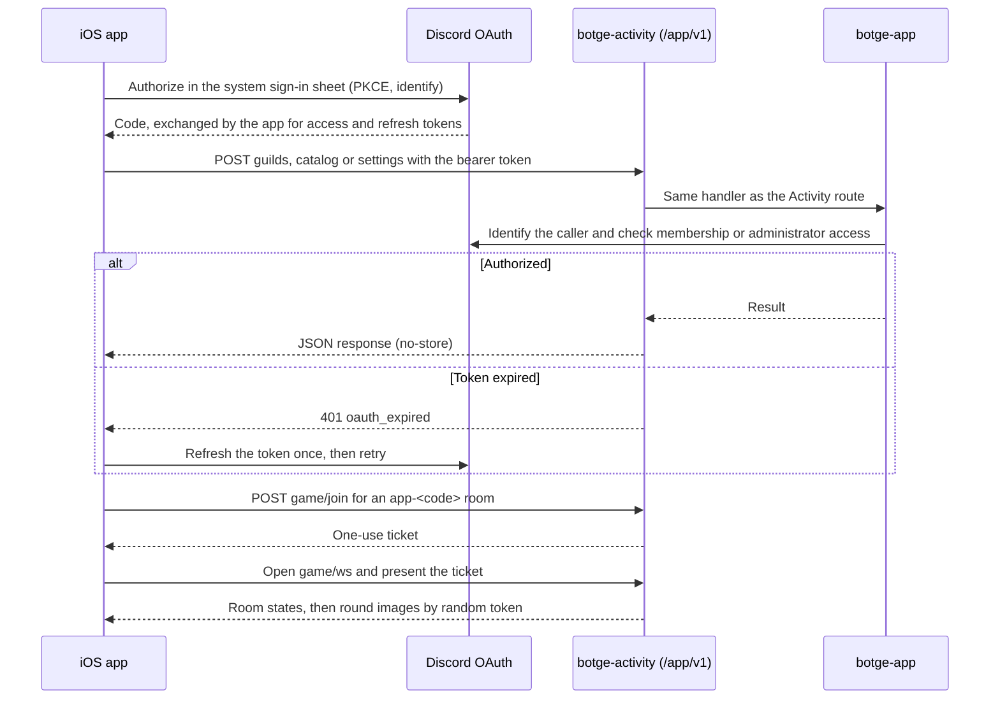

# Rust bot architecture

The production image builds one [Rust binary](../crates/botge/Cargo.toml). Discord commands and the
Activity API share the same emote catalog. The [Activity](../activity/README.md) uses TypeScript in
the browser and Go at the origin. The [iOS app](../ios/README.md) uses SwiftUI.

## Diagram exports

The editable Mermaid diagrams in [`diagrams/`](diagrams/) track the workspace, request and release
flows. The linked PNGs are existing exports. The workspace guide defines the full dependency policy:

- [Workspace architecture](diagrams/architecture.mmd) ([PNG](architecture.png)): adapters,
  application operations, domain records, providers, and persistence.
- [Request and data flow](diagrams/request-flow.mmd) ([PNG](request-flow.png)): Discord compositions
  and authenticated Activity voice settings.
- [VM deployment topology](deployment.png): Compose services, persistent data, and optional API
  ingress.
- [Development and release workflow](diagrams/development-workflow.mmd)
  ([PNG](development-workflow.png)): local hooks, language checks, and approved deployment.
- [Startup and shutdown](startup.png): initialization, optional services, and gateway readiness.
- [Discord interactions](discord-interactions.png): extensible command, autocomplete, modal, and
  message handling.

Diagrams show architectural boundaries rather than an exhaustive feature list. New ports reuse the
command and interaction handlers; only implemented handlers are active. The request-flow diagram
illustrates emote rendering and an Activity voice-settings save. Personal border requests identify
the caller without requiring guild authorization.

## Startup and dependencies

The root Cargo manifest is a virtual workspace. The executable lives in
[`crates/botge/`](../crates/botge/), alongside the private libraries in [`crates/`](../crates/). The
startup module wires the dependencies together. The Activity routes validate input and translate
failures into HTTP responses. The Discord adapter exchanges OAuth codes and checks permissions.
Storage owns redb transactions, and the voice worker applies settings to Discord.

The larger services separate their internal responsibilities into child modules:

- [`commands.rs`](../crates/botge-discord/src/commands.rs) dispatches to
  [`commands/`](../crates/botge-discord/src/commands/): composition, message prefixes, autocomplete,
  shortcuts, registration, and cleanup.
- [`activity.rs`](../crates/botge-activity/src/activity.rs) shares authentication and state across
  the voice, catalog, personal border, and guessing game routes in
  [`activity/`](../crates/botge-activity/src/activity/).
- [`game.rs`](../crates/botge-app/src/game.rs) keeps the guessing game's rooms, rounds, and scores
  in memory: it owns tickets, seats, and the emote pool, and
  [`game/`](../crates/botge-app/src/game/) holds one room's state and scoring, the match task, and
  token generation. A room belongs to one Activity instance, or one `app-<code>` room of the iOS
  app, in one guild and closes with its last connection. The Activity adapter issues a one-use
  ticket to a verified guild member, seats the WebSocket that presents it, and serves each round's
  image under a random token so the emote's name stays on the server until the reveal.
- [`providers.rs`](../crates/botge-emotes/src/emotes/providers.rs) keeps networking and snapshots
  separate from [`normalization.rs`](../crates/botge-emotes/src/emotes/providers/normalization.rs)
  and [`events.rs`](../crates/botge-emotes/src/emotes/providers/events.rs).
- [`rendering.rs`](../crates/botge-emotes/src/emotes/rendering.rs) coordinates downloads and
  encoding; its [`child modules`](../crates/botge-emotes/src/emotes/rendering/) own layout planning,
  media probing, and WebP timing.

Feature tests live in each child module's `tests.rs`. Parent test modules retain shared fixtures and
scenarios that exercise dispatch, authentication, networking, or the complete render pipeline.

### Workspace boundaries

The [workspace guide](../crates/README.md) defines the private crate responsibilities and allowed
production dependencies. Domain records and pure rules sit below storage and provider services.
Application operations authorize and coordinate those services; Discord and Activity translate
transport requests without owning database access. Authorization calls the application's injected
`GuildAccess` capability, implemented by `botge-discord`. Voice consumes an application
settings-source capability. The executable wires concrete services together.

The dependency-policy integration test guards these edges and keeps fixture features out of
production declarations. Cargo rejects cycles. Shared metadata and lint policy live in the root
manifest; validation, coverage and build inputs include every workspace crate.

The internal health listener is independent of the Activity API. It exposes process liveness at
`/healthz`, gateway readiness at `/readyz`, and operation counters at `/metrics`. Ready/Resumed
enables readiness; reconnect stages remove it without failing liveness. `--healthcheck` checks local
readiness, and `--verify-database` reads an offline redb backup without loading Discord credentials.
See [production operations contracts](PRODUCTION.md).

## Activity request flow

Discord routes `/` to the Go origin on Cloud Run and `/botge-api` to the Rust bot on the VM through
a [public HTTPS endpoint](../activity/README.md#api-https-endpoint). The Go origin verifies
signatures on HTML and asset requests and sends HTML with a strict Content Security Policy. The
browser reaches the bot through Discord's API mapping. The iOS app uses the same HTTPS endpoint with
bearer-only requests under `/app/v1`.

The diagram shows a voice settings save. The API verifies signatures and accepts a one-use code on
`/auth`; every other route needs the bearer token. Botge asks Discord who owns a token when it
exchanges the code and again every five minutes, so a revoked token stops working within that
window; membership and roles are checked on every request. Guilds and members come from the gateway
cache, which the `GUILDS` and privileged `GUILD_MEMBERS` intents keep current, so role, owner,
channel and membership changes apply at once. Until the gateway delivers a guild, requests for it
answer that Botge is still connecting. Discord sends every member at startup only for guilds of up
to 250 members; a member the cache lacks is fetched over REST and reused for 30 seconds. Denials are
reused for 10 seconds, and a Discord rate limit on OAuth pauses those calls until its retry time.
Responses over 1 KiB are gzip-compressed when the client accepts it. An open catalog keeps a
ticketed WebSocket at `/catalog/ws` that reports when the server's catalog changed, so the page
reloads it without polling.

Guild owners and administrators can manage voice and emote settings. Members can read the server
catalog. Adding or removing emotes follows the server's emote management policy, and personal border
settings use the authenticated user's ID.

The API offers voice channels the bot can view and join. Startup, gateway resume, and a periodic
check reconcile the saved channel. A call that is already connected only has its status refreshed;
guilds that keep failing are retried with backoff up to an hour, and saving settings retries at
once. Clearing it requests a disconnect. The optional voice status emoji stays saved when the toggle
is off.

## iOS app request flow

With `BOTGE_APP_API=true`, the same handlers are also mounted under `/app/v1` with a bearer-token
gate instead of the Discord proxy signature, plus `POST /app/v1/guilds` for the server picker. The
app has no client secret: it exchanges its login code with Discord itself using PKCE and keeps the
tokens in the Keychain. Membership, administrator, and personal-border checks are the same as for
the Activity.

## Emote catalog and rendering

Each guild catalog combines individually added 7TV emotes, the guild-selected 7TV set, and the
global 7TV set in that order. Each source within 7TV remains opt-in. A single 7TV WebSocket
invalidates affected snapshots after changes. Timed refreshes and a reconnect refresh cover missed
events. Autocomplete can use cached results when a provider is slow. The shared refresh continues in
the background so later requests can use the updated snapshot. Requests retain immutable provider
snapshots rather than cloning their records; an in-flight request keeps its previous view across a
refresh. Bounded provider JSON normalization and shortcut searches run on blocking workers. Added
emotes and guild settings use separate redb tables. The add transaction checks duplicate IDs and
names, and the API checks guild membership and roles before writing.

Discord defers emote interactions while it resolves names and reads media. Downloads use provider
CDN allowlists and the nginx cache where available. The renderer admits up to five requests at once,
caps file sizes, and runs FFmpeg on local image files. Columns follow the Activity preview's
proportions. The renderer synchronizes each overlaying group before compositing so all layers retain
their timing. Animated compositions export WebP with variable frame delays and use the longest
source animation's duration.

### Managed catalog history

The Activity and iOS Server settings show catalog history to current guild administrators. Every
committed addition, removal, or emote policy change creates a revision in the same redb transaction
as the change. A bulk action records each committed item in order. A guild's first change records
its prior managed state as a starting revision. Botge retains up to 32 revisions per guild.

Choose a revision and preview the emote additions, removals, changed details and policy changes.
Confirming the preview creates a new revision and reloads open guild catalogs. If a different edit
commits after the preview, Botge asks the administrator to preview the restore again. Restore
preserves the saved emote order and respects the operator's switch for individual additions. Live
7TV set contents are fetched independently, even when a restore changes which set the guild uses.

The proxy and bearer routes share the same implementation. Send `guildId` to
`POST /catalog/history`, add `revision` for `POST /catalog/history/preview`, and pass the preview's
`currentRevision` as `expectedRevision` to `POST /catalog/history/restore`.

## Checks and deployment

The [test guide](../tests/README.md) owns toolchains, check commands, coverage gates and live
testing. The [workflow guide](../.github/workflows/README.md) owns CI, the release PR, image
promotion and approved deployment; the development-workflow diagram above summarizes it.
[Production contracts](PRODUCTION.md) cover readiness, backups and the cost policy. See the
[roadmap](https://github.com/orgs/MrewyOrg/projects/2/views/6) for planned commands and
integrations.
